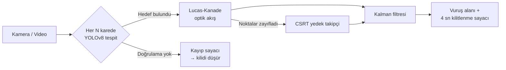

# ✈️ UAV_TRACKER — Savaşan İHA Hibrit Hedef Takip Sistemi

**HÜRTÜRK İHA Takımı** · TEKNOFEST Savaşan İHA

Sabit kanatlı İHA'mızın kamerasından rakip İHA'yı gerçek zamanlı tespit edip kilitlenen görüntü işleme sistemi. YOLO tespitini klasik takip algoritmalarıyla birleştirerek, modelin hedefi kaçırdığı karelerde de takibin kopmamasını sağlar.

> **Aktif sürüm: [`UAV_V1`](UAV_V1/)** — YOLOv8 + Lucas-Kanade + CSRT + Kalman. Diğer sürümler karşılaştırma için denenen alternatif yaklaşımlardır.

---

## 🧠 Nasıl Çalışır? (UAV_V1)



- **YOLOv8 tespit:** Her `RE_DETECT_INTERVAL` karede bir tam tarama yapar. Adaylar merkeze uzaklık, güven skoru ve alan büyüklüğüne göre puanlanır.
- **Lucas-Kanade optik akış:** Tespit yapılmayan ara karelerde hedefin üzerindeki noktaları izler. İleri-geri doğrulama ile hatalı noktaları eler.
- **CSRT yedek takipçi:** Optik akış noktaları azaldığında devreye girer.
- **Kalman filtresi:** Hedefin hızını tahmin eder, kutuyu yumuşatır, kısa süreli kayıplarda konumu tahminle sürdürür.
- **Hayalet takip koruması:** Hedef belirli sayıda kare boyunca YOLO ile doğrulanamazsa kilit düşürülür ve yeni hedef aranır.
- **Yarışma kuralları:** Hedef vuruş alanında ve minimum boyut şartını sağlıyorsa 4 saniyelik kilitlenme sayacı başlar.

---

## 📂 Sürümler

Farklı takip yaklaşımlarını aynı test videoları üzerinde karşılaştırmak için 6 sürüm geliştirildi:

| Klasör | Yaklaşım | Not |
| :--- | :--- | :--- |
| [`UAV_BASE`](UAV_BASE/) | YOLOv8 + LK + CSRT | İlk hibrit yapı |
| [`UAV_V1`](UAV_V1/) ⭐ | YOLOv8 + LK + CSRT + Kalman | **Kullanılan sürüm** — yörünge tahmini ve kilitlenme sayacı |
| [`UAV_V2`](UAV_V2/) | V1 + CLAHE | Ters ışık / güneş patlamasına karşı kontrast iyileştirme |
| [`UAV_V3`](UAV_V3/) | YOLOv8 + ByteTrack + LK + Kalman | CSRT yerine ByteTrack denemesi |
| [`UAV_V4`](UAV_V4/) | V3 + mikro gürültü filtresi | ByteTrack iyileştirmeleri |
| [`UAV_V5`](UAV_V5/) | BoT-SORT + ReID + CLAHE + Kalman | Görsel yeniden tanıma denemesi |

Karşılaştırmaların sonucunda yarışma çalışmalarına V1 ile devam ediliyor.

---

## 🚀 Kurulum ve Çalıştırma

```bash
pip install ultralytics opencv-contrib-python torch numpy
python3 UAV_V1/UAV_TRACKER_V1.py
```

Çalıştırınca kaynak seçimi istenir: `0` canlı kamera, `1`–`6` test videoları.

> ⚠️ Model ağırlıkları (`.pt`) ve test videoları boyut nedeniyle repoda yok. Bunları [`MODELS_and_VİDEO`](MODELS_and_VİDEO/) klasörüne koyup (videolar `1.mp4` … `6.mp4`) script'in başındaki `MODEL_PATH` ve video yollarını kendi bilgisayarına göre güncelle.

---

## 🛠️ Yol Haritası

- [ ] Raspberry Pi 5 + Hailo-8 üzerinde HEF modelle çalışan sürümün repoya eklenmesi
- [ ] GPS'ten görüntüye geçiş (hedefe GPS ile yaklaşıp görüntüyle kilitlenme)
- [ ] MAVLink ile gimbal / yön kontrolü entegrasyonu
- [ ] Sabit dosya yollarının komut satırı argümanlarına taşınması

---

**Geliştiren:** [Can Ahmet Atik](https://github.com/canahmet1407) — HÜRTÜRK İHA Takımı Kaptanı & Görüntü İşleme Lideri
